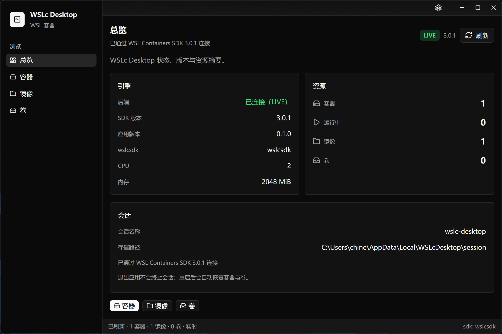
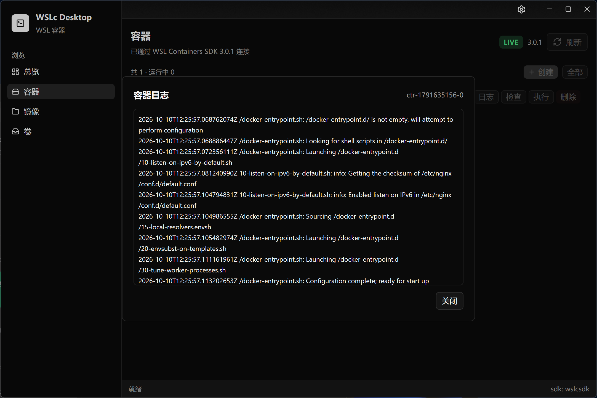
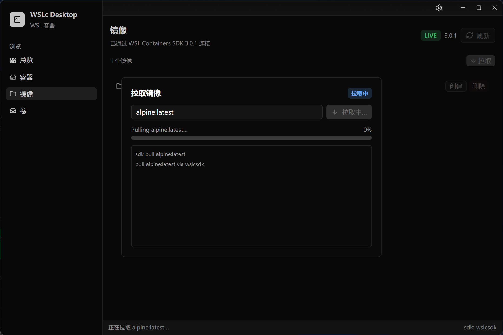

# WSLc Desktop

面向 Windows **WSL Containers（WSLc）** 的轻量级桌面管理器，基于 [GPUI Kit](https://gpui-kit.com) 构建。

网站：<https://timeroute.github.io/wslc-desktop-website/>

下载：[Releases](https://github.com/timeroute/wslc-desktop/releases) 中的 `WSLc.Desktop-<version>-x86_64.msi`。

| 总览 | 容器日志 | 拉取镜像 |
|------|----------|----------|
|  |  |  |

用独立会话 `wslc-desktop`（`%LOCALAPPDATA%\WSLcDesktop\`）管理容器、镜像与 VHD 卷，与默认 `wslc` CLI 会话隔离。Rust 绑定使用自维护 fork [`timeroute/wslc-rs`](https://github.com/timeroute/wslc-rs)（OpenContainer / Logs / named volumes）。MSI **不捆绑** `wslcsdk.dll`：首次启动以阻塞弹窗安装/更新 SDK。

## 安装（推荐）

1. 打开 [Releases](https://github.com/timeroute/wslc-desktop/releases)
2. 下载最新 `WSLc.Desktop-<version>-x86_64.msi` 并安装
3. 确保本机 [WSL 2.9.3+](https://learn.microsoft.com/windows/wsl/install)（`wsl --update`）
4. 首次启动按提示完成 SDK 安装；之后即可拉取镜像、创建容器

同版本 MSI 会覆盖旧安装（固定 `UpgradeCode` + `AllowSameVersionUpgrades`）。若「应用和功能」里已有重复条目，先卸干净再装新包。

需要 VC++ 运行库时，安装 [VC++ Redistributable](https://learn.microsoft.com/en-us/cpp/windows/latest-supported-vc-redist)。

## 功能

| 页面 | 能力 |
|------|------|
| **总览**（默认） | 引擎 / SDK / 应用版本、会话 CPU·内存、容器·镜像·卷摘要 |
| **Containers** | 创建（端口 / bind / 命名卷）；行内 Start / Stop / Restart / Logs / Inspect / Exec / Remove；catalog + `OpenContainer` 跨重启恢复 |
| **Images** | 拉取弹窗；行内创建容器 / 删除 |
| **Volumes** | 弹窗创建（1/2/5/10 GiB）；行内删除 |
| **设置** | 可滚动；语言、主题、会话 CPU / 内存（下次新建会话生效） |

Logs 走 fork 的 `LogsOptions`（底层 `wslc --session wslc-desktop container logs`）。退出应用**不会** `terminate` 会话，便于下次重连。

## 从源码构建

**要求：** Windows 10/11 x64 · WSL 2.9.3+ · Rust stable-MSVC · VS 2022 C++ + Windows SDK + CMake

```powershell
wsl --update
rustup default stable-x86_64-pc-windows-msvc
cargo run                 # 开发
cargo build --release     # 发布二进制
cargo test
```

### 打 MSI

另需 [WiX Toolset 3.14+](https://wixtoolset.org/) 与 `cargo install cargo-wix`：

```powershell
cargo wix
# 产物：target\wix\WSLc.Desktop-<version>-x86_64.msi
# 当前 0.1.2：WSLc.Desktop-0.1.2-x86_64.msi
```

可选：`cargo wix --no-build`（已有 release 产物时）、`cargo wix --sign`（需 `signtool`）。

### 发布到 GitHub Release

打 `v*` tag 会触发 [Windows MSI](.github/workflows/windows-msi.yml) 工作流：构建 MSI 并创建 Release 挂载安装包。

```powershell
# 版本与 Cargo.toml 对齐，例如 0.1.2 → v0.1.2
git tag v0.1.2
git push origin v0.1.2
```

也可：push / PR 到 `main` 仅上传 artifact；或 Actions → **Windows MSI** → **Run workflow**。

## 依赖 `wslc-rs` fork

```toml
[target.'cfg(windows)'.dependencies]
wslc = { git = "https://github.com/timeroute/wslc-rs", rev = "<commit>" }
```

在 fork 打补丁并 push 后，更新这里的 `rev`，再 `cargo build` / 提交 `Cargo.lock`。可用 `WSLC_CLI_PATH` 覆盖日志用的 `wslc.exe`。

## 架构

```text
UI (GPUI Kit)
  ├─ SDK 安装弹窗 → NuGet 缓存 wslcsdk.dll
  ├─ Session "wslc-desktop"（与 CLI 隔离，退出不 terminate）
  └─ 拉取 / 创建 / 日志 → 阻塞弹窗或行内操作
```

| 资源 | 持久化 |
|------|--------|
| Containers | `%LOCALAPPDATA%\WSLcDesktop\catalog.json` + `OpenContainer` |
| Volumes | catalog |
| 会话 prefs | `%LOCALAPPDATA%\WSLcDesktop\prefs.json` |

```text
.github/workflows/   Windows MSI CI / Release
wix/                 MSI 快捷方式与图标
src/app/             界面（overview / containers / images / volumes / settings）
src/wslc/            SDK 封装与 Live 会话
```

## 许可

Apache-2.0
